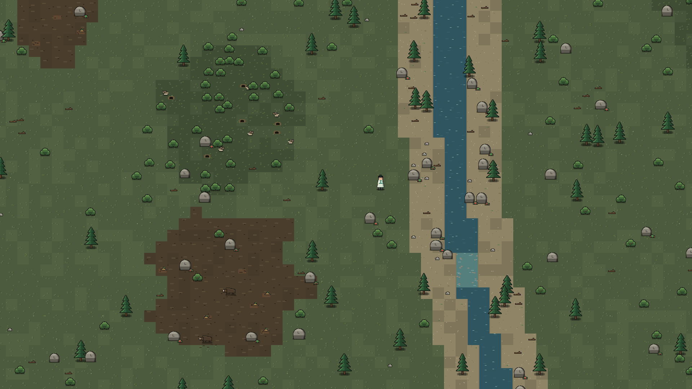

# Planície Verdejante: primeiro trecho jogável no Godot — 2026-11-26

> O pedido está em [prompts/08-planicie-primeiro-trecho.md](prompts/08-planicie-primeiro-trecho.md). O design completo, com regras, fórmulas e valores, está em `design/gdd/plains-first-stretch.md`.

## Resultado

Apertando **F5** no Godot:
- o personagem acorda **sem nada** numa clareira da Planície, ao lado de um riacho;
- o terreno é gerado **por semente**, em blocos que se formam ao redor dele conforme ele anda;
- ele recolhe **sílex** e **galho rijo** com **E**, fabrica e equipa a **faca de pedra** no inventário (**I**) e corta com ela (**J** ou clique esquerdo);
- caça um **coelho**, que foge para a toca;
- enfrenta um **javali**, que avisa, investe em linha reta e precisa se recompor;
- cura-se com a **Grama Sangue-de-Coelho** e encontra **Raiz Amarga** onde o javali fuçou.

Na campanha, esse despertar continua previsto para depois da derrota no prólogo. O F5 abre direto nele só para testar.



*Captura ampla, 1920×1080 em pixels reais:*
- no centro, o personagem na clareira;
- a leste, o riacho com a margem e um vau (trecho raso, em verde-água);
- a noroeste, o campo de arbustos com as tocas;
- a sudoeste, o lamaçal com dois javalis e as raízes.

## Como testar pelo F5 no Windows

1. Abra o Godot .NET: `C:\Users\Raul\Tools\Godot\4.7.2-stable-mono\Godot_v4.7.2-stable_mono_win64\Godot_v4.7.2-stable_mono_win64.exe`.
2. No gerenciador de projetos, abra `D:\Progr\SpiritOfMurin\project.godot`. Se ele não estiver na lista: **Import**, escolha o arquivo e depois **Edit**.
3. Na primeira vez, clique em **Build** (martelo, no canto superior direito) para compilar o C#.
4. Aperte **F5**. A cena principal agora é `res://src/Plains/Plains.tscn`.

**Para repetir um mundo de que gostou:**
1. Anote a semente que aparece no canto superior direito ("semente 20261126").
2. No editor, abra `src/Plains/Plains.tscn`, selecione o nó raiz **Plains** e preencha **Seed** no Inspector. Com **0**, cada F5 sorteia um mundo novo.
3. Pela linha de comando, também funciona: `... --path D:\Progr\SpiritOfMurin -- --seed=20261126`.

**Sementes usadas nos testes:**
- **20261126**: a da captura e do vídeo;
- **777**.

## Controles

| Ação | Teclado | Mouse |
|---|---|---|
| Andar (8 direções) | W A S D (e setas) | — |
| Andar quieto (o coelho não escuta de longe) | segurar **Shift** | — |
| Pegar o que está no chão / tirar carne e pele da caça | **E** (aparece "E · pegar …" sobre o objeto) | — |
| Abrir e fechar o inventário | **I** ou **Tab** (Esc também fecha) | — |
| No inventário: escolher / usar, equipar ou fabricar | **W/S** / **E** | — |
| Corte (faca: curto, encadeia 2; espada: encadeia 3) | **J** | clique esquerdo |
| Passo (sem direção: para trás; com direção: para aquele lado) | **L** | clique direito |

O mapa de entradas está em Project › Project Settings › Input Map. As ações novas são **inventory** e **sneak**, gravadas por `tools/godot/setup_input.gd`.

## O que ficou jogável

| Pedido | Como ficou |
|---|---|
| Mundo em blocos por semente | Blocos de 16×16 tiles (512 px). Ficam montados 5×5 ao redor do jogador, e os blocos a mais de 3 de distância são liberados. A mesma semente e a mesma coordenada dão sempre o mesmo terreno e os mesmos objetos, em qualquer ordem de chegada |
| Reconhecer o lugar ao voltar | O riacho, a margem, o campo de tocas e o lamaçal são função da semente. Voltar a um bloco o monta de novo, idêntico |
| Coleta preservada | O que foi recolhido não volta ao chão ao sair e voltar ao bloco. Animal morto volta como carcaça, e carcaça vazia não volta. Vale durante a partida, até fechar o jogo |
| Três habitats ligados | **Margem**: sílex, galhos, pinheiros e pedras com erva. **Campo de arbustos**: arbustos e tocas com coelhos. **Lamaçal**: terra revirada com Raiz Amarga, pegadas de casco e javalis. Tudo a pé a partir da clareira |
| Início garantido | Clareira livre. Na margem, a poucos passos: 2 sílex, 2 galhos e uma pedra com Grama Sangue-de-Coelho. O campo de tocas e o lamaçal ficam a 12–16 tiles, a oeste |
| Semente discreta | No canto superior direito, em cinza |
| Cidades e túmulos depois | `PlainsGenerator.AddStamp(tile, chão, objetos)` reserva tiles antes das regras aleatórias. Há um teste para isso |
| Mãos vazias | Acorda sem nada. J sem arma avisa "Mãos vazias" |
| Faca de pedra | 1 Sílex + 1 Galho Rijo, consumidos uma vez. Sem material, avisa o que falta. Equipa pelo inventário. Corte curto (alcance de 22 px, contra 34 da espada), mais rápido, encadeia 2. A lâmina aparece como uma lasca cinza curta |
| Espada preservada | Continua no campo de teste `src/Main/Main.tscn`, com os mesmos tempos e cadeia de 3. Os 14 testes dos controles passam |
| Coelho | Pula perto da toca. Ao ouvir passos, ergue as orelhas, congela 0,35 s e corre até a toca em duas arrancadas. Some e volta a sair depois de 4,5 s. Andando ele escuta a 95 px; andando quieto (Shift), a 26 px; parado, a 14 px. Esperando perto da toca e chegando quieto, a faca o alcança |
| Carcaça do coelho | E tira Carne Macia e depois Pele Fina, uma vez cada (é preciso ter uma lâmina na mão) |
| Javali | Fuça no lamaçal. A 110 px, raspa o casco (poeira), abaixa a cabeça e o olho fica vermelho: são 0,8 s de aviso. A cabeça segue você por pouco mais da metade do aviso; depois a direção fica fixa, e marcas no chão mostram a linha. Investe reto a 240 px/s por até 170 px e fica 1 s tonto (pontos girando sobre a cabeça) |
| Dano pelo contato real | A investida só machuca se o corpo do javali chegar a 15 px de você (2 de Vida). O seu golpe só acerta o que está dentro do alcance e do arco da lâmina enquanto ela está ativa. Durante o aviso e a investida, o golpe é desviado ("o couro grosso desvia"); na recomposição, acerta |
| Ajuste nos dados | `assets/data/plains/BoarTuning.tres`: aviso, velocidade, distância, recomposição e outros. Também se edita pelo Inspector do Godot |
| Ervas | **Grama Sangue-de-Coelho** junto às pedras: usada pelo inventário, devolve 4 de Vida aos poucos, em 6 s (a parte que ainda vem aparece em verde na barra). **Raiz Amarga** na terra revirada pelo javali: devolve 1 de Vida na hora |
| Nome e quantidade | Toda coleta mostra "+1 Nome (tem N)" |
| **Barra de Vida (seu pedido durante a sessão)** | A Vida virou uma **barra com porcentagem** ("Vida 80%"), no mesmo estilo da barra de Qi do protótipo: fundo de pincel escuro, contorno, trilho escuro e preenchimento com uma linha clara em cima, na cor da vida do art bible (#7a3a32) |
| Desmaio | Com a Vida em 0, você desmaia e acorda na clareira com tudo o que carregava |

## Vídeo do javali

`production/qa/evidence/2026-11-26_planicie/javali-aviso-investida-abertura.gif`, com cerca de 5 s. O original está em `.avi`, gravado pelo próprio Godot. Mostra:
1. o javali fuçando;
2. o personagem se aproximando e o aviso começando;
3. a investida em linha reta, enquanto o personagem anda para o lado;
4. o javali tonto e dois cortes de faca acertando: a vida dele vai de 5 para 3, e a Vida do personagem fica em 100%.

## Testes

**Executor:** o atual do projeto, com cenas de verificação que saem com código 0 quando tudo passa.
- **Unidade:** `tests/unit/UnitRunner.tscn`, que roda os métodos marcados com `[UnitTest]`.
- **Integração:** `PlainsCheck` e `ControlsCheck`, que apertam teclas e botões pela própria entrada do Godot.

**gdUnit4 (não instalado, por um bloqueio):**
- O addon GDScript **v6.2.3** (novembro/2026) já corrige problemas do Godot 4.7.
- Os testes do jogo são em C#. O executor C# (**gdUnit4Net**) não tem versão estável desde a **5.0.0** (junho/2025, feita para Godot 4.4 e .NET 8). A linha 5.1 ainda está em pré-lançamento (5.1.0-rc7).
- O projeto compila offline, com os pacotes que vêm no editor. Pôr um pacote pré-lançamento do NuGet no build quebraria isso e não garante compatibilidade com o Godot.NET.Sdk 4.7.2 e o net10.0.
- Por isso, o `/test-setup` não foi executado. O `commands.test` do `project.yaml` continua apontando para o gdUnit4, que ainda não existe no projeto.

**Para os testes abrirem no monitor 2 (sua pergunta):**
```powershell
.\tools\godot\testes-janela.ps1                # monitor 2 (padrão)
.\tools\godot\testes-janela.ps1 -Monitor 1     # monitor 1
.\tools\godot\testes-janela.ps1 -Seed 777      # outra semente
```
- O script roda, com janela, o teste de unidade, os controles da espada e o PlainsCheck.
- O Godot conta as telas a partir de 0, então o monitor 2 é `--screen 1`. Para rodar uma cena à mão, acrescente `--screen 1` ao comando.
- Confirmado pelo próprio teste: "window on screen 1 of 2 (Windows)".

**Resultados:**

| Teste | O que confere | Resultado |
|---|---|---|
| `dotnet build` | compilação | 0 avisos, 0 erros |
| Unidade (`tests/unit/`) | duas sementes dão mundos diferentes; mesma semente em **três ordens de visita** (linhas, ao contrário e um trajeto que volta ao mesmo bloco) dá blocos idênticos; bordas iguais à função do mundo e riacho contínuo entre blocos; ids únicos e um só bloco dono por objeto; **em 60 sementes**, clareira livre e sílex, galho, erva, toca, javali e raiz alcançáveis a pé; carimbo de lugar feito à mão; faca fabricada uma vez; fabricação sem material não muda nada; coleta e partes da carcaça uma vez; fuga do coelho em duas arrancadas até a toca; coelho não ouve quem anda quieto; coelho volta a sair e morre com um golpe; aviso do javali de 0,8 s com direção fixa; desvio lateral evita a investida reta; recomposição de 1 s com golpe aceito; contato causa dano uma vez; javali morre em 5 golpes nas aberturas; arco da lâmina; porcentagem da barra de Vida | **18/18**, sem janela e com janela |
| `PlainsCheck`, semente **20261126** | 41 verificações, listadas abaixo | **41/41**, sem janela (4 execuções seguidas) e com janela no monitor 2 |
| `PlainsCheck`, semente **777** | as mesmas 41 | **41/41**, sem janela (4 execuções seguidas) e com janela no monitor 2 |
| `ControlsCheck`, na cena do campo com espada | os 14 testes anteriores (andar, cadeia 1-2-3 por J e por clique, passo por L e por clique direito, câmera) | **14/14**, sem janela e com janela |
| Execução normal (o F5 por linha de comando, com janela) | a cena principal sobe, mostra o despertar e roda 5 s sem erros | sem erros (log em `f5-execucao-normal.log`) |

**As 41 verificações do PlainsCheck, nas duas sementes:**
1. Acorda de mãos vazias, com Vida cheia e a semente à vista. J sem arma não corta.
2. Sílex perto do início. E pega o sílex ("+1 Sílex (tem 1)"); um segundo E não duplica. E pega o galho.
3. Ir para longe libera o bloco. Ao voltar, ele é montado de novo, o sílex recolhido **não volta**, os outros 20 objetos voltam e nada fica duplicado.
4. Andando pelas teclas, atravessa a borda de um bloco e volta. O inventário fica igual.
5. I abre o inventário. E na receita fabrica a faca; uma segunda vez avisa "Falta: Sílex, Galho Rijo". E na faca a equipa. I fecha.
6. A faca corta com J sem passar de 2 golpes na cadeia. O clique esquerdo corta, o clique direito dá o passo e L dá o passo.
7. O coelho mora numa toca no campo de arbustos. Andando perto, ele ergue as orelhas, corre e se esconde. Esperando na toca e chegando quieto, a faca o abate. A carcaça dá carne e pele, uma vez cada.
8. O javali mora no lamaçal, com Raiz Amarga perto. Ele avisa por **0,82 s**; andar para o lado evita a investida; a investida é reta; o contra-ataque na recomposição acerta (5 → 4); ficar na linha causa 2 de dano no contato (o mais perto que chegou foram 13–15 px). A barra mostra "Vida 80%". O javali não segue até a clareira.
9. A Grama é pega junto à pedra e, usada, a Vida sobe aos poucos: 8 → 8,7 em 1 s → 10 em 6,5 s. A Raiz Amarga é pega com nome e quantidade.

**Ajustes feitos nos testes durante a sessão (nenhum mudou o jogo):**
- **Tecla perdida:** a entrada simulada às vezes perdia uma tecla quando dois quadros de física caíam no mesmo quadro de tela. Agora o teste espera a tecla ser entregue.
- **Medição do aviso:** o tempo do aviso passou a ser medido pelo contador de física do próprio Godot.
- **Arbustos no caminho:** o teste do coelho agora contorna os arbustos.
- **Isolamento:** na hora do coelho e do javali, o teste remove os outros coelhos e javalis vizinhos. Um segundo javali acertou o personagem numa das execuções.

## Evidências

Pasta `production/qa/evidence/2026-11-26_planicie/`:

| Arquivo | O que é |
|---|---|
| `planicie-ampla-semente-20261126.png`, `planicie-ampla-semente-777.png` | captura ampla (1920×1080, pixels reais) das duas sementes, com a mesma estrutura e terrenos diferentes |
| `f5-despertar-intro.png`, `f5-planicie-janela.png`, `f5-execucao-normal.log` | a cena principal pela execução normal, com janela: a tela do despertar e a Planície 5 s depois |
| `javali-aviso-investida-abertura.gif` / `.avi` | o vídeo do javali |
| `semente-20261126/`, `semente-777/` | 13 capturas do PlainsCheck com janela: despertar, sílex, inventário com a receita, faca equipada, corte de faca, coelho de orelhas em pé, carcaça, aviso, investida, recomposição, acerto (Vida 80%), cura e Raiz Amarga |
| `controles-espada/` | as 5 capturas do ControlsCheck no campo com espada |
| `*.log` | saídas de todos os testes |

## Onde fica

| O quê | Caminho |
|---|---|
| Cena principal (F5) | `src/Plains/Plains.tscn` (`PlainsGame.cs`) |
| Gerador por semente | `src/Plains/PlainsGenerator.cs`, regras em `assets/data/plains/plains_worldgen.json` |
| Blocos ao redor do jogador | `src/Plains/PlainsWorld.cs`, `ChunkGround.cs` |
| Memória da partida | `src/Plains/WorldState.cs` |
| Itens, receitas, inventário | `src/Items/`, dados em `assets/data/plains/plains_items.json` |
| HUD (barra de Vida, inventário, semente, mensagens) | `src/Plains/PlainsHud.cs` |
| Coelho e javali | `src/Creatures/` (comportamento separado do desenho, testável), ajustes em `assets/data/plains/RabbitTuning.tres` e `BoarTuning.tres` |
| Faca, Vida, cura, andar quieto | `src/Player/Player.cs`, valores em `assets/data/PlayerTuning.tres` |
| Campo de teste com espada | `src/Main/Main.tscn` (não é mais a cena do F5) |
| Testes | `tests/unit/` (UnitRunner), `tests/integration/PlainsCheck.*`, `ControlsCheck.*`, `PlainsCapture.*` (captura ampla e vídeo) |
| Rodar com janela no monitor 2 | `tools/godot/testes-janela.ps1` |
| AVI → GIF | `tools/capture/avi_to_gif.py` |

## Números ainda provisórios

Todos estão em dados, não no código:
- **Javali:** 0,8 s de aviso, 240 px/s, 170 px, 1 s de recomposição, dano 2, vida 5.
- **Coelho:** audição de 95 / 26 / 14 px, 4,5 s escondido.
- **Faca:** alcance de 22 px.
- **Ervas:** Grama 4 de Vida em 6 s; Raiz 1 na hora.
- **Vida máxima:** 10.
- **Mundo:** densidades dos objetos.

As faixas seguras estão no GDD, seção 7.

## Limitações e próximas entregas

- **Sem salvamento ainda:** a coleta e as caças valem até fechar o jogo. Meditar e Continuar entram na próxima entrega.
- **Raiz Amarga:** ainda só cura 1. O uso como antídoto e pasta depende de veneno (víbora) e de preparo.
- **Carne e pele:** ainda não têm uso (fogueira, receitas). A habilidade Esfolar ainda não existe, e a pele sai sempre igual.
- **Ainda faltam:**
  - a espada simples no posto de vigia;
  - a saída para o Vale de Bambus;
  - XP, níveis e atributos;
  - as outras espécies;
  - Qi.
- **Mundo infinito:** longe do início, os habitats seguem o ruído e podem ficar repetitivos. Ainda não há bordas da região.
- O `project.yaml` (`commands.test`) continua com o comando do gdUnit4, que não está instalado. Use os comandos acima.
